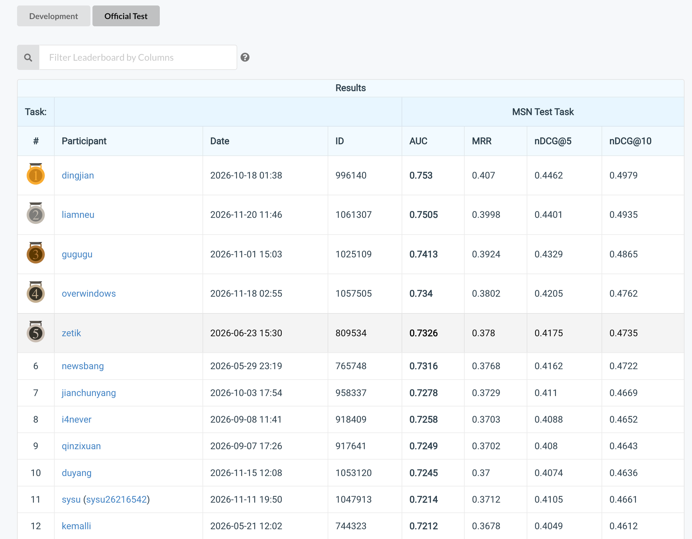
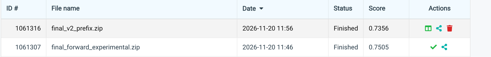

# MIND 新闻推荐：点击微调的 PLM 新闻编码器 + LightGBM 融合

本项目参加的是 [MIND News Recommendation](https://msnews.github.io/) 排行榜（Codabench，Official Test = MIND-large 测试集，按 AUC 排名）。任务是根据用户的浏览历史，为一次曝光中的候选新闻排序。

方法分两层：
1. **内容模型**：用通用预训练文本模型（BGE / E5 / Qwen3-Embedding）编码新闻，并用点击信号微调，再配上多兴趣用户编码器。
2. **融合**：用 LightGBM（lambdarank）融合各内容模型的分数、类别与实体匹配特征，以及只看过去的曝光时间特征。

没有使用任何在 MIND 上训练过的第三方推荐权重，也没有使用测试标签。

## 结果

| 提交 | 说明 | dev AUC | 线上 AUC（Official Test） |
|---|---|---|---|
| **正式版** `final_v2_prefix.zip` | 8 个内容分支 + LightGBM，时间特征只用打分时刻**之前**的曝光 | 0.7307 | **0.7356** |
| 前视对照 `final_forward_experimental.zip` | 正式版 + 14 个"未来曝光"特征（见下文） | 0.7458 | 0.7505 |

> ⚠️ **关于 0.7505**：排行榜上显示的是前视对照版。它与正式版的模型完全相同，只是让排序树额外看到了"这条新闻在当前时刻之后还被推荐了多少次、之后是否又推给了同一个用户"等信息。这些统计来自测试周公开的（无标签）曝光日志，**真实线上系统在打分时拿不到**，也不符合官方"按内容建模新闻、按历史建模兴趣"的任务定义。因此它只作为对照实验。**只用过去信息的正式结果是 0.7356。** 详见 [REPORT.md 第 4 节](REPORT.md#4-时间与曝光特征只看过去-vs-前视)。

排行榜（2026-11-20）：



两次最终提交：



参照：公开论文在 MIND-large 上的最好结果约为 0.73（UniUM-Fastformer-Pretrain 0.7304，Fastformer+PLM-NR 0.7268）。

## 方法概览

```
曝光 = (用户历史, 候选新闻 ×N, 时间)
   │
   ├─ 第一层：8 个内容模型，各自给每个候选打点击分
   │    新闻编码器：标题+摘要(64 token) → 预训练文本模型 → 投影 + 类别/子类别嵌入
   │    用户编码器：最近 50 条历史 → 自注意力 → 多个兴趣向量
   │    打分：按候选加权的多兴趣点积 + 候选"吸引力"偏置
   │    训练：1 个点击正例配 4 个同曝光负例，softmax 交叉熵
   │
   └─ 第二层：LightGBM lambdarank
        输入：8 个分数（曝光内 z-score）+ 类别/实体匹配 + 9 个严格前缀曝光特征
        最终分 = 0.25 × 全层 BGE + 0.75 × LightGBM
```

| 内容分支 | 预训练模型 | 微调方式 | 单模型 dev AUC |
|---|---|---|---|
| 冻结 BGE | BAAI/bge-base-en-v1.5 | 编码器冻结 | 0.6997 |
| 冻结 Qwen-8B | Qwen/Qwen3-Embedding-8B | 编码器冻结 | 0.6985 |
| BGE 顶部两层 ×2 种子 | bge-base-en-v1.5 | 上 2 层随点击训练 | 0.6965–0.7048 |
| 全层 BGE ×2 种子 | bge-base-en-v1.5 | 12 层全部训练 | 0.7111 / 0.7054 |
| 全层 E5 | intfloat/e5-base-v2 | 12 层全部训练 | 0.7070 |
| 非对称 4B | Qwen3-Embedding-4B + 8B | 历史侧冻结 8B，候选侧 4B + LoRA | 0.7050 |

主要结论：
- **用点击信号微调比换更大的冻结模型重要得多**：冻结 8B 只有 0.6985，全层微调的 base 模型达到 0.7111。
- 只看过去的曝光特征（新闻"年龄"、近 1/6/24 小时曝光量等）贡献约 +0.016。
- 测试集 87.5% 是冷新闻，因此全层微调在线上的收益大于 dev 上的收益。

### 验证协议
- **dev 按用户分成 A、B 两半**：分支组合和融合权重只在 A 半上选择，B 半只用来确认。
- **树只看样本外分数**：喂给树训练的内容分数，来自没见过当天点击的"影子模型"。这些影子模型只用更早的日期训练。
- **最终版重训**：内容模型按 dev 选出的轮数，用 train+dev 重新训练。
- **dev 与线上一致**：四次提交的 dev 和线上排序完全一致，线上比 dev 稳定高 0.002–0.005。

完整说明见 **[REPORT.md](REPORT.md)**。

## 代码结构

核心代码（`scripts/`）：

| 文件 | 作用 |
|---|---|
| `prepare.py` | 把原始 TSV 转成整数化数组，保留行序和完整用户历史 |
| `encode.py` | 用冻结的通用编码器提取新闻向量 |
| `click_text.py` / `click_train.py` | 点击监督的 PLM 微调（全层 / LoRA），batch 内新闻去重 |
| `upper.py` | 缓存 BERT 第 10 层输出，只训练顶部两层 |
| `asym_head.py` | 非对称分支：历史侧冻结，候选侧微调 |
| `recommender.py` | NRMS 式、按候选加权的多兴趣用户模型，训练与推理 |
| `exposures.py` | 严格前缀的曝光、时间特征，以及类别、实体匹配特征 |
| `trees.py` / `fusion.py` | LightGBM lambdarank 融合、A/B 半选择与复核 |
| `ranking.py` | 生成提交文件、校验格式、计算按曝光平均的指标（与官方 `evaluate.py` 对齐） |
| `independent_submission.py` | 对照原始 test TSV 独立校验提交包 |
| `experimental_exposure.py` / `experimental_forward.py` | **仅用于前视对照实验**的未来曝光特征 |
| `verify_prefix.py` / `check_*.py` | 时间泄露与边界条件检查 |

其余脚本（`colab_*`、`fleet_*`、`recovery_*`、`*_queue.py`、`*_admission.py` 等）负责在 Google Colab A100 上并行调度训练、心跳监控、断点续训和结果同步。它们与具体的算力环境耦合，复现时可以只参考核心代码，用自己的方式调度。

## 数据与环境

- 数据：MIND-large，请按 [Microsoft Research License](https://github.com/msnews/MIND/blob/master/MSR%20License_Data.pdf) 从 [官方页面](https://msnews.github.io/) 下载。本仓库不包含任何数据。
- 官方评测脚本 `evaluate.py` 请从官方页面获取，放在仓库根目录（`ranking.py` 用它做一致性核对）。
- 依赖见 `requirements.txt`。GPU 训练在 Colab A100 上完成，总计约 360 CU。

## 致谢与参考

- 数据集：Wu et al., *MIND: A Large-scale Dataset for News Recommendation*, ACL 2020。
- 方法借鉴：NRMS（多头自注意力用户编码）、MINER（多兴趣、按候选加权）、PLM-NR（用预训练语言模型做新闻编码器）。
- 预训练模型：[BAAI/bge-base-en-v1.5](https://huggingface.co/BAAI/bge-base-en-v1.5)、[intfloat/e5-base-v2](https://huggingface.co/intfloat/e5-base-v2)、[Qwen3-Embedding](https://huggingface.co/Qwen)（8B / 4B / 0.6B）。

## License

MIT
